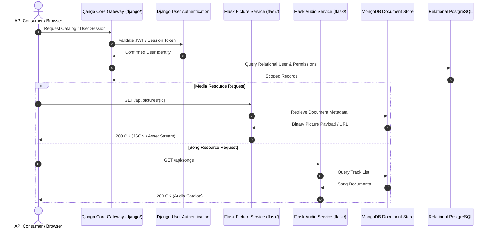

<div align="center">
  <h1>ibm-backend-capstone</h1>
  <p>Backend architecture, REST APIs, and microservices for the IBM Backend Development Professional Certificate capstone.</p>

  <p>
    <a href="LICENSE"></a>
    
    
    
    
    <a href="https://github.com/itsgoharrehman/ibm-backend-capstone/stargazers"></a>
    <a href="https://github.com/itsgoharrehman/ibm-backend-capstone/issues"></a>
  </p>
</div>

---

> [!IMPORTANT]
> **Academic Honesty and Institutional Integrity**:
> This repository contains completed capstone coursework for the **IBM Backend Development Professional Certificate** program hosted on Coursera / edX. In accordance with IBM and Coursera honor codes, enrolled students are strictly prohibited from copying, plagiarizing, or submitting any portion of this work. This repository is maintained strictly for portfolio demonstration and pedagogical reference.

---

## Architecture and Microservices Topology

The application decomposes core business capabilities into decoupled, containerized services:



---

## Service Decomposition

| Service | Directory | Framework & Tech | Purpose |
| :--- | :--- | :--- | :--- |
| **Django Core** | `django/` | Django 4.2+, ORM, Admin | Primary authentication gateway, relational models, user lifecycle |
| **Flask Media Service** | `flask/pictureroutes.py` | Flask 3.0, PyMongo | Picture catalog endpoints, image metadata upload, and retrieval |
| **Flask Audio Service** | `flask/songroutes.py` | Flask 3.0, PyMongo | Music and audio resource management, query filtering |
| **Database Connector** | `labs/` | PyMongo, raw sockets | MongoDB connection pools and query benchmark test harnesses |
| **Deployment Engine** | `deploymain/` | Docker, Kubernetes | Container definition (`Dockerfile`) and Pod manifests (`deployment.yml`) |

---

## Directory Structure

```
ibm-backend-capstone/
├── .github/
│   ├── ISSUE_TEMPLATE/
│   │   ├── bug_report.yml          # Defect reporting form
│   │   └── question.yml            # Conceptual question form
│   ├── PULL_REQUEST_TEMPLATE.md    # Academic integrity PR verification
│   └── dependabot.yml              # Weekly automated pip dependency scanner
├── deploymain/                     # Containerization and Kubernetes manifests
│   ├── Dockerfile                  # Production container image definition
│   ├── deployment.yml              # Kubernetes service and deployment specification
│   └── views.py                    # Deployment endpoint health checks
├── django/                         # Django core service
│   ├── admin.py                    # Administrative portal models
│   ├── models.py                   # Relational database schema
│   ├── urls.py                     # Route dispatcher
│   └── views.py                    # Core business logic handlers
├── flask/                          # Decoupled microservices
│   ├── pictureroutes.py            # Image resource endpoints
│   └── songroutes.py               # Audio catalog endpoints
├── labs/                           # Experimental lab scripts and Mongo connectors
│   ├── mongo_connect.py            # MongoDB driver connection verification
│   ├── mongo_query.py              # Aggregation and query testing
│   ├── server.py                   # Development test server
│   └── server2.py                  # Alternate port test server
├── requirements.txt                # Python environment dependencies
├── LICENSE                         # Educational Coursework License
├── SECURITY.md                     # Security policy and disclosure protocol
├── CONTRIBUTING.md                 # Academic archive contribution guidelines
└── CODE_OF_CONDUCT.md             # Contributor Covenant v2.1
```

---

## Running Locally

### Prerequisites

* Python 3.10 or higher
* Docker (for container execution)
* MongoDB instance (local or MongoDB Atlas)

### Setup and Running

1. Clone the repository:
   ```bash
   git clone https://github.com/itsgoharrehman/ibm-backend-capstone.git
   cd ibm-backend-capstone
   ```

2. Install dependencies:
   ```bash
   pip install -r requirements.txt
   ```

3. Run the Flask microservice:
   ```bash
   python flask/pictureroutes.py
   ```

4. Build and run with Docker:
   ```bash
   docker build -t ibm-capstone deploymain/
   docker run -p 8080:8080 ibm-capstone
   ```

---

## Governance and Licensing

* **License**: Licensed under the [Educational Coursework License](LICENSE).
* **Security & Vulnerabilities**: Please review [SECURITY.md](SECURITY.md) for vulnerability reporting.
* **Academic Integrity**: See [CONTRIBUTING.md](CONTRIBUTING.md) regarding policy for completed coursework archives.
